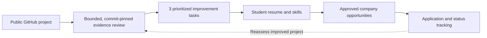
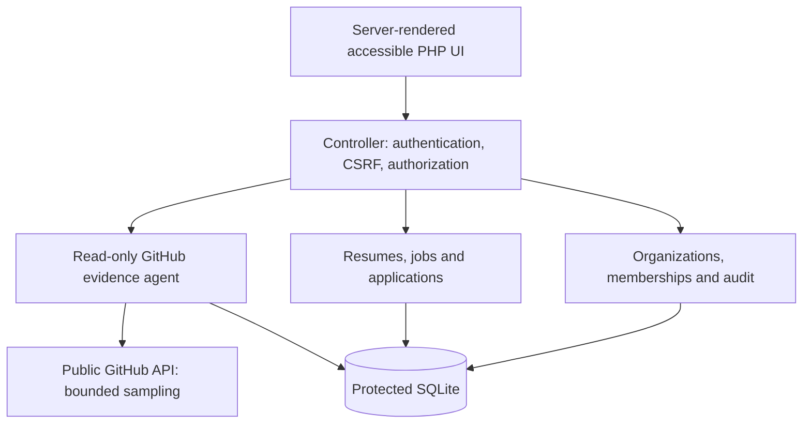

# EIDOLON PATHWAY

### Evidence → Improvement → Opportunity → Application

**A privacy-aware, evidence-grounded career platform for first-time developers.** Built from InternHunt for the [Code for a Billion — Bharat Agentic-AI Hackathon 2026](https://codeforindia.org/hackathon), in the **Tech Employment for Youth** impact area.

> **Release status — 10 November 2026:** The private `main` branch now contains the standalone PHP/SQLite student, employer, college and admin workflows, including an isolated synthetic demo. **This is a tested local prototype, not an internet-ready recruitment service.** Social sign-in, organization self-service requests, student-to-college affiliation approvals, fine-grained access grants and theme/analytics upgrades are planned, not yet shipped.

**Quick links:** [Run the demo](#try-the-four-role-demo) · [What makes it different](#the-core-idea) · [Features](#what-is-implemented) · [Judge walkthrough](docs/JUDGE_DEMO.md) · [Deployment strategy](docs/DEPLOYMENT.md) · [Security boundaries](#security-and-trust)

---

## The problem we're solving

A student might have built real projects but cannot prove what they did, what to improve, or how their work aligns with available opportunities. Employers and colleges also need trustworthy **and permissioned** information rather than opaque rankings or unverified resume keywords.

PATHWAY connects **project evidence, actionable feedback, resumes, opportunities, and applications** in one workflow. It does not pretend that a repository scan can accurately measure an entire person's ability.

## The core idea



**Not just another resume score:** PATHWAY's distinctive direction is a **traceable, repeatable improvement loop**. The engine cites inspected source lines, explains sample limitations and produces tasks with acceptance criteria. Future research will measure whether those tasks improve demonstrable evidence compared with generic portfolio advice.

## What is implemented?

| Workspace | Available in the current local prototype |
| --- | --- |
| **Student** | Registration, profile, ATS-friendly resume editor/print preview, GitHub evidence assessment, job browsing, applications and history |
| **Company** | Authorized representative login, job publishing, tenant-scoped applicant review and status updates |
| **College** | Authorized placement officer login, institution-scoped dashboard, privacy-gated student records |
| **EIDOLON admin** | CLI-created administrator, organization approvals and audit views |
| **Demo and testing** | Isolated synthetic database seeder; PHP checks and browser-level HTTP smoke tests |

**Not yet implemented:** company/college self-service access requests, student affiliation approval workflow, field-level disclosure controls, Google/GitHub/LinkedIn sign-in, light/dark/system preferences and enhanced analytics. These belong to the planned **Mission 009**.

### Important interpretation limits

- **ATS-friendly** means readable, single-column formatting designed for text extraction—not guaranteed success with every ATS or job.
- **Evidence-based** does not mean the engine has verified a candidate's identity, authorship, employability or complete skill level.
- **Demo listings and organizations** are fictional/unaffiliated, not real vacancies or partners.
- **No placement or research impact claims** are made without actual consent-based measurements.

## Try the four-role demo

**Requirements:** PHP 8.4 recommended (PHP 8.2+ with PDO SQLite and sessions), terminal, browser; Python 3 for optional smoke tests. GitHub assessment also needs internet access.

```bash
git clone https://github.com/skandamp-sudo/eidolon-pathway.git
cd eidolon-pathway

php bin/init.php
php bin/seed_demo.php --confirm-demo-seed --demo-db=var/pathway_demo.sqlite
php bin/serve.php 8080 --demo
```

Open **http://127.0.0.1:8080** on the **same computer**. This app intentionally binds to localhost and is **not safe to expose directly online**.

The seeder creates distinct generated credentials in ignored, local `var/demo_credentials.json` (mode `0600`). **Never commit or share that file.** Use only the disposable demo environment.

| Persona | Local route | Judge can inspect |
| --- | --- | --- |
| Student | `/login` | Resume, repository assessment, jobs, application |
| Recruiter | `/company/login` | Fictional employer postings, permitted applicants |
| Placement officer | `/college/login` | Consented vs confidential student access |
| Platform administrator | `/admin/login` | Organization review and audit trail |

The dataset includes an **unaffiliated DSATM demo college record**, fictional employers, synthetic students and six clearly marked **non-real** internship examples.

**[Full judge walkthrough, role-by-role instructions, and video script](docs/JUDGE_DEMO.md)**

## Architecture



- **Runtime:** PHP 8.4, server-rendered HTML/CSS, PDO SQLite, no Docker or XAMPP.
- **Migrations:** five checksummed database migrations; the original legacy InternHunt MySQL code and Git history are excluded from this repository.
- **GitHub evidence:** deterministic, bounded, read-only collection; no downloaded code execution.
- **Isolation:** the primary database, sessions, demo credentials and generated files are excluded from Git and served from outside the public document root.

## Verification and reproducibility

The synchronized release documentation reported **363 passing automated checks** in the standalone publishing copy (222 PHP checks + 141 HTTP checks). Those counts are not an independent third-party security audit and should be **rerun on the exact submission commit**. The original larger development workspace also contained tests that were not part of this clean publishing tree.

Start with:

```bash
php tests/sqlite/core_test.php
php tests/evidence/agent_test.php
php tests/employment/e2e_demo_test.php
```

The complete regression commands are in the [judge walkthrough](docs/JUDGE_DEMO.md).

## Security and trust

The local prototype includes password hashing, parameterized database access, output escaping, CSRF tokens, scoped authorization, request limits, restricted security headers, and private local storage. Its design prioritizes **deny-by-default access** and transparent disclosure of limitations.

**Public-release blockers:** production HTTPS and trusted hosts, `Secure` cookies, privileged MFA, verified invitations and email recovery, secure session/identity linking, persistent backups, cross-tenant security review, operational logging and independent penetration testing. Do not publish seeded privileged accounts or real applicant information.

**No platform is unhackable.** Passing tests demonstrates specific checked behaviors, not complete OWASP compliance or a security certification.

## Vercel and cloud deployment

The current application requires a persistent PHP backend and local database/session storage. **Vercel alone is not a drop-in host for this application**: PHP support is community-maintained, and serverless scratch storage is temporary. A later Vercel-hosted landing page or frontend can connect to a securely deployed, persistent backend.

See **[deployment decision, architecture and security gates](docs/DEPLOYMENT.md)**. The official hackathon requires an open-source repository and cloud deployment by **15 November 2026**; a screenshot-only page is not a substitute for the functioning app.

## Screenshots

Real, privacy-sanitized screenshots of the **current** student, resume, recruiter, college and admin screens will be added after the next UI verification pass. No mockup is being represented here as a working interface.

## Hackathon, research and honest impact

**Hackathon story:** large youth employment problem → practical evidence-linked career workflow → working multi-role demonstration → measured, real-world usefulness.

**Research question:** Can commit-pinned, explainable improvement tasks outperform generic portfolio feedback in citation accuracy, actionability and demonstrable follow-up improvements? That requires baselines, consent, reviewer scoring and real experiments. **Results are not yet claimed.**

**Tools:** AgentFoundry was used in the hackathon workflow, together with other coding assistants, including Codex and Antigravity. The final submission should itemize actual usage and independently verified outcomes, not claim an assistant's work as proof of security or agent autonomy.

**Project lineage:** InternHunt is the foundation; EIDOLON PATHWAY is the integrated student-to-employment evolution. The repository assessment agent is one component—not the whole product.

---

**EIDOLON — Built on evidence. Earned through trust.**
