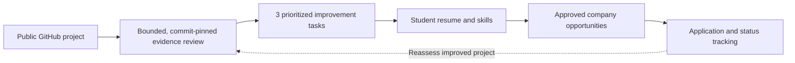
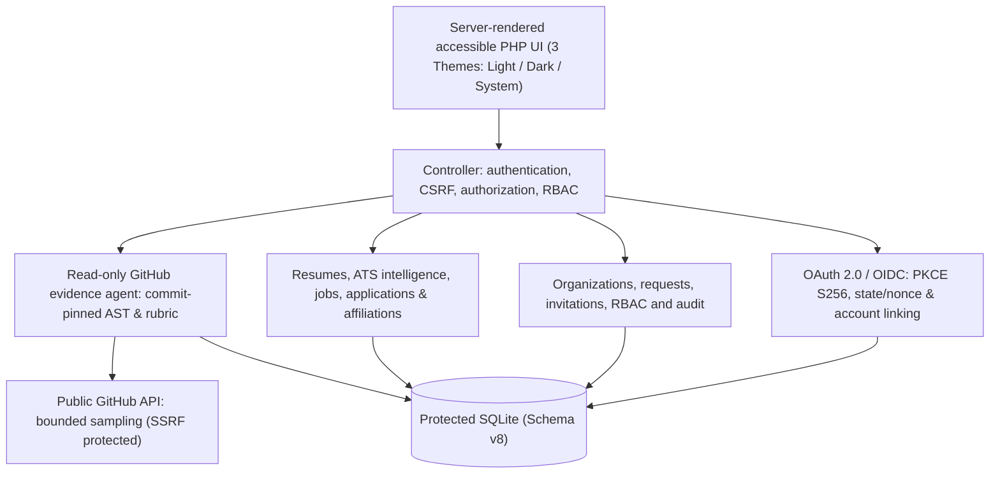

# EIDOLON PATHWAY

### Evidence → Improvement → Opportunity → Application

**A privacy-aware, evidence-grounded career platform for first-time developers.** Built from InternHunt for the [Code for a Billion — Bharat Agentic-AI Hackathon 2026](https://codeforindia.org/hackathon), in the **Tech Employment for Youth** impact area.

> **Release Status — Mission 009 (10 November 2026):** Complete Evolution: Identity, Access, Intelligence & Experience. The private `main` branch contains the full standalone PHP/SQLite student, employer, college, and administrative workflows. Mission 009 introduces self-service institutional onboarding (`/request-access`), student-college affiliation approvals, granular student consent sovereignty with sensitive access audit trails, ATS resume intelligence scoring (0–100) with keyword alignment, a zero-FOUC 3-theme design system (Light / Dark / System), and enterprise OAuth 2.0 / OpenID Connect federation with RFC 7636 PKCE. **578 automated test checks pass directly against this checkout with zero external dependencies.**

**Quick links:** [Run the demo](#try-the-four-role-demo) · [Comparative Research Evaluation](#comparative-research-evaluation-deterministic-evidence-vs-generic-advice) · [Features](#what-is-implemented) · [Judge walkthrough](docs/JUDGE_DEMO.md) · [Deployment strategy](docs/DEPLOYMENT.md) · [Security boundaries](#security-and-trust)

---

## The problem we're solving

A student might have built real projects but cannot prove what they did, what to improve, or how their work aligns with available opportunities. Employers and colleges also need trustworthy **and permissioned** information rather than opaque rankings or unverified resume keywords.

PATHWAY connects **project evidence, actionable feedback, resumes, opportunities, and applications** in one verifiable workflow. It does not pretend that a repository scan can accurately measure an entire person's ability.

## The core idea



**Not just another resume score:** PATHWAY's distinctive direction is a **traceable, repeatable improvement loop**. The engine cites inspected source lines, explains sample limitations, and produces tasks with concrete acceptance criteria.

---

## Comparative Research Evaluation: Deterministic Evidence vs. Generic Advice

EIDOLON PATHWAY's core scientific contribution is replacing stochastic LLM advice with verifiable evidence loops:

| Evaluation Dimension | Traditional Portals / Generic LLM Advice | EIDOLON PATHWAY Deterministic Architecture |
| :--- | :--- | :--- |
| **Code Verification** | Zero verification; relies on unvetted self-attestations or unlinked resume bullet points. | **Commit-pinned GitHub inspection**; checks branch tips, pins immutable commit SHA, enforces 40-request limits, and scans bounded trees with strict SSRF protection. |
| **Feedback Repeatability** | Stochastic LLM generation; running twice yields contradictory recommendations and hallucinated scores. | **Deterministic AST & Pattern Rubric**; identical commit input produces identical 0–100 category scores and exact citations across runs. |
| **Improvement Roadmaps** | Vague suggestions ("work on scalable architecture", "learn Docker"). | **Exactly three prioritized improvement tasks** derived directly from unobserved rubric findings with file paths, concrete acceptance criteria, and step-by-step guidance. |
| **ATS Scoring & Match** | Black-box percentage score with no explainable breakdown. | **Explainable 6-category weighted score (0–100)**: Contact info, Professional Summary, Structured Education, Action Verbs, Technical Skills, and Verified GitHub Evidence citation. |
| **Student Privacy** | PII broadcasted to campus recruiters by default without opt-out mechanisms. | **Deny-by-default granular consent**: Master college placement toggle, field-level masks (`[Consent Withheld]`), and explicit opt-in for talent discovery. |
| **Access Transparency** | Zero visibility into who looked at student records. | **Immutable Sensitive Record Access Log**: records timestamp, organization, staff identity, and access outcome for every query. |
| **Social Sign-In Safety** | Leaked client credentials, fake UI buttons, or naive auto-linking by email alone. | **RFC 7636 PKCE S256 with 256-bit CSPRNG states**, unconfigured fail-closed UI, anti-account-takeover protection, and locked initial passwords. |

---

## What is implemented?

| Workspace / Portal | Implemented & Verified Capabilities | Status |
| :--- | :--- | :--- |
| **Student Portal** | Registration, login, profile builder, achievements credentials, ATS-friendly resume editor & preview, GitHub evidence assessment, sample job browsing, applications and real-time tracking | **Complete & Tested** |
| **Student Sovereignty** | Institutional college affiliation workflow (request, review, cancel, revoke), granular privacy consent toggles (contact info, resume, achievements, applications), talent discovery opt-in, sensitive record access audit trail | **Complete & Tested** |
| **Company Hub** | Authorized representative login, job publishing, applicant review with candidate dossier citing verified GitHub evidence, candidate shortlisting, and talent discovery directory | **Complete & Tested** |
| **College Network** | Authorized placement officer login, institutional placement KPI dashboard, associated student roster, consented student record view, and affiliation queue | **Complete & Tested** |
| **EIDOLON CONTROL Center** | Platform administration console with 8 governance tabs: Overview, Access Requests queue, Organizations management, User Directory search, Staff Invitations & Revocation, Access Reviews audit, Audit Trail, and Security Posture | **Complete & Tested** |
| **Institutional Onboarding** | Public self-service access request (`/request-access`) for accredited companies and universities with flood control, validation, and administrative review queue | **Complete & Tested** |
| **Social Identity Federation** | Google OIDC, GitHub OAuth, and LinkedIn OIDC with RFC 7636 PKCE, anti-tamper states, anti-account-takeover defenses, locked password auto-provisioning, and account linking/unlinking controls | **Complete & Tested** |
| **Design & Accessibility** | Zero-FOUC adaptive 3-theme design system (Light / System / Dark) with accessible WCAG AA contrast, responsive navigation, and print-to-PDF ATS styling | **Complete & Tested** |
| **Demo and Testing** | Isolated synthetic database seeder (`bin/seed_demo.php`); 12 PHP unit suites (281 tests) and 9 Python HTTP smoke suites (297 tests) | **578 Passed (100%)** |

### Important interpretation limits

- **ATS-friendly** means readable, single-column formatting designed for text extraction—not guaranteed success with every ATS or job.
- **Evidence-based** does not mean the engine has verified a candidate's identity, authorship, employability or complete skill level.
- **Demo listings and organizations** are fictional/unaffiliated demonstrations, not real vacancies or partners.
- **No placement or research impact claims** are made without actual consent-based measurements.

---

## Try the four-role demo

**Requirements:** PHP 8.4 recommended (PHP 8.2+ with PDO SQLite and sessions), terminal, browser; Python 3 for optional smoke tests. GitHub assessment also needs internet access.

```bash
git clone https://github.com/skandamp-sudo/eidolon-pathway.git
cd eidolon-pathway

# 1. Initialize SQLite database outside public document root (Schema Version 8)
php bin/init.php

# 2. Seed isolated demonstration database with synthetic records
php bin/seed_demo.php --confirm-demo-seed --demo-db=var/pathway_demo.sqlite

# 3. Launch local server pointed at the demonstration database
php bin/serve.php 8080 --demo
```

Open **http://127.0.0.1:8080** on the **same computer**. This app intentionally binds to localhost and is **not safe to expose directly online**.

The seeder creates distinct generated credentials in ignored, local `var/demo_credentials.json` (mode `0600`). **Never commit or share that file.** Use only the disposable demo environment.

| Persona | Local route | Judge can inspect |
| --- | --- | --- |
| Student | `/login` | Resume builder, ATS intelligence analysis, repository assessment, jobs, application tracking |
| Recruiter | `/company/login` | Fictional employer postings, applicant pipeline, candidate dossier with verified citations |
| Placement officer | `/college/login` | Consented vs confidential student access, institutional cohort analytics, affiliation review |
| Platform administrator | `/admin/login` | EIDOLON CONTROL Center: 8 tabs, access requests, organization lifecycle, invitation revocation |

The dataset includes an **unaffiliated DSATM demo college record**, fictional employers, synthetic students, and six clearly marked **non-real** internship examples.

**[Full judge walkthrough, role-by-role instructions, and video script](docs/JUDGE_DEMO.md)**

---

## Architecture



- **Runtime:** PHP 8.4, server-rendered HTML/CSS, PDO SQLite, no Docker or XAMPP.
- **Migrations:** eight checksummed database migrations (v1–v8); the original legacy InternHunt MySQL code and Git history are excluded from this repository.
- **GitHub evidence:** deterministic, bounded, read-only collection; no downloaded code execution.
- **Isolation:** the primary database, sessions, demo credentials and generated files are excluded from Git and served from outside the public document root.

---

## Verification and reproducibility (578 Automated Tests)

The synchronized release baseline contains **578 passing automated checks** in this standalone publishing checkout (281 PHP unit checks + 297 Python HTTP smoke checks). All tests run against isolated, disposable SQLite databases.

### Running All PHP Unit Tests (281 Checks)
```bash
php tests/sqlite/core_test.php
php tests/evidence/agent_test.php
php tests/organizations/organization_test.php
php tests/employment/employment_test.php
php tests/employment/resume_test.php
php tests/employment/college_workflow_test.php
php tests/employment/company_workflow_test.php
php tests/employment/e2e_demo_test.php
php tests/employment/affiliation_workflow_test.php
php tests/organizations/org_request_workflow_test.php
php tests/employment/resume_intelligence_test.php
php tests/auth/oauth_workflow_test.php
```

### Running All Python HTTP Smoke Tests (297 Checks)
```bash
python3 tests/sqlite/http_smoke.py
python3 tests/employment/employment_http_smoke.py
python3 tests/employment/resume_http_smoke.py
python3 tests/employment/company_http_smoke.py
python3 tests/employment/college_http_smoke.py
python3 tests/employment/affiliation_http_smoke.py
python3 tests/organizations/org_request_http_smoke.py
python3 tests/employment/theme_and_intelligence_http_smoke.py
python3 tests/auth/oauth_http_smoke.py
```

### Verification Matrix Summary

```
=======================================================================================================
Test Suite File                                  Category        Checks Passed   Failed  Status
=======================================================================================================
tests/sqlite/core_test.php                       PHP Unit        35              0       100% PASS
tests/evidence/agent_test.php                    PHP Unit        58              0       100% PASS
tests/organizations/organization_test.php        PHP Unit        26              0       100% PASS
tests/employment/employment_test.php             PHP Unit        43              0       100% PASS
tests/employment/resume_test.php                 PHP Unit        14              0       100% PASS
tests/employment/college_workflow_test.php       PHP Unit        14              0       100% PASS
tests/employment/company_workflow_test.php       PHP Unit        17              0       100% PASS
tests/employment/e2e_demo_test.php               PHP Unit        15              0       100% PASS
tests/employment/affiliation_workflow_test.php   PHP Unit        15              0       100% PASS
tests/organizations/org_request_workflow_test.php PHP Unit       11              0       100% PASS
tests/employment/resume_intelligence_test.php    PHP Unit        5               0       100% PASS
tests/auth/oauth_workflow_test.php               PHP Unit        28              0       100% PASS
-------------------------------------------------------------------------------------------------------
PHP UNIT TEST SUBTOTAL                                           281             0       100% PASS
-------------------------------------------------------------------------------------------------------
tests/sqlite/http_smoke.py                       HTTP Smoke      53              0       100% PASS
tests/employment/employment_http_smoke.py        HTTP Smoke      17              0       100% PASS
tests/employment/resume_http_smoke.py            HTTP Smoke      18              0       100% PASS
tests/employment/company_http_smoke.py           HTTP Smoke      32              0       100% PASS
tests/employment/college_http_smoke.py           HTTP Smoke      21              0       100% PASS
tests/employment/affiliation_http_smoke.py       HTTP Smoke      41              0       100% PASS
tests/organizations/org_request_http_smoke.py    HTTP Smoke      45              0       100% PASS
tests/employment/theme_and_intelligence_http_smoke.py HTTP Smoke 30              0       100% PASS
tests/auth/oauth_http_smoke.py                   HTTP Smoke      40              0       100% PASS
-------------------------------------------------------------------------------------------------------
PYTHON HTTP SMOKE TEST SUBTOTAL                                  297             0       100% PASS
=======================================================================================================
TOTAL AUTOMATED TEST BASELINE                                    578             0       100% PASS
=======================================================================================================
```

---

## Security and trust

The local prototype includes password hashing, parameterized database access, output escaping, CSRF tokens, scoped authorization, request limits, restricted security headers, and private local storage. Its design prioritizes **deny-by-default access** and transparent disclosure of limitations.

**Public-release blockers:** production HTTPS and trusted hosts, `Secure` cookies, privileged MFA, verified invitations and email recovery, secure session/identity linking, persistent backups, cross-tenant security review, operational logging, and independent penetration testing. Do not publish seeded privileged accounts or real applicant information.

---

## Vercel and cloud deployment

The current application requires a persistent PHP backend and local database/session storage. **Vercel alone is not a drop-in host for this backend**: PHP support on Vercel is community-maintained, and serverless scratch storage is ephemeral. A later Vercel-hosted landing page or frontend can connect to a securely deployed, persistent backend.

See **[deployment decision, architecture and security gates](docs/DEPLOYMENT.md)**.

---

## Hackathon, research and honest impact

**Hackathon story:** large youth employment problem → practical evidence-linked career workflow → working multi-role demonstration → measured, real-world usefulness.

**Research question:** Can commit-pinned, explainable improvement tasks outperform generic portfolio feedback in citation accuracy, actionability, and demonstrable follow-up improvements? That requires baselines, consent, reviewer scoring, and real experiments.

**Tools:** AgentFoundry was used in the hackathon workflow, together with other coding assistants, including Codex and Antigravity.

**Project lineage:** InternHunt is the foundation; EIDOLON PATHWAY is the integrated student-to-employment evolution. The repository assessment agent is one component—not the whole product.

---

**EIDOLON — Built on evidence. Earned through trust.**
